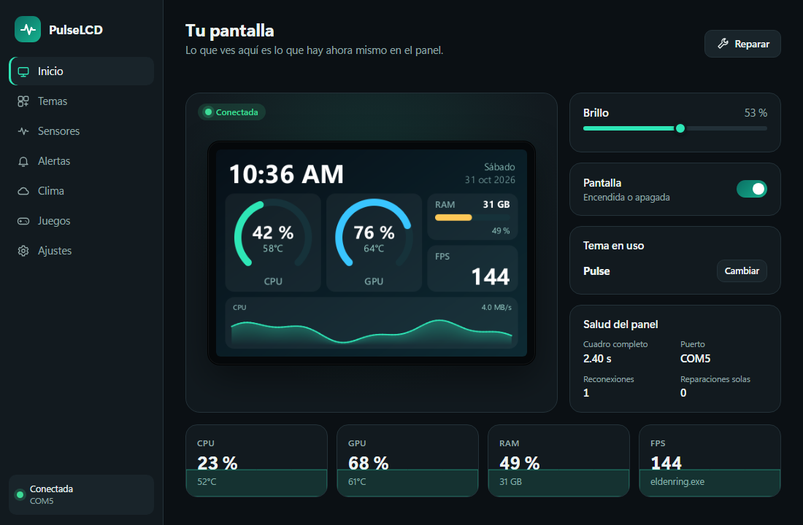
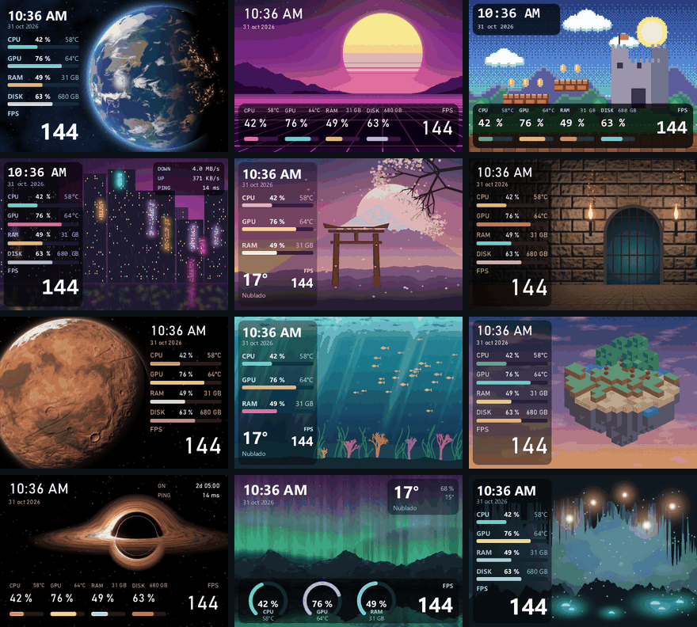
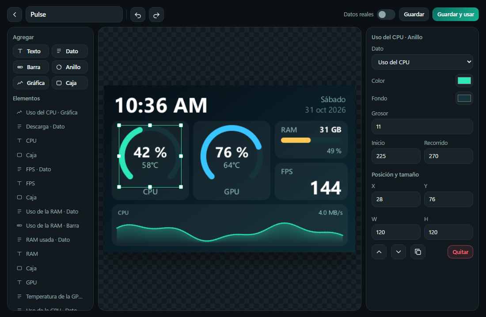

<div align="center">

# PulseLCD

**Tu PC en una pantalla pequeña: estadísticas en vivo, temas que dibujas tú y un panel que se cuida solo.**

[English](README.md) · **Español**

[](https://github.com/Yesid-Robayo/PulseLCD/releases)
[](LICENSE)

[](https://ko-fi.com/yesidrobayo)

<br>



</div>

> [!WARNING]
> **Gratis y de código abierto, sin garantía.** PulseLCD lo hace una sola persona y se ofrece tal cual: puede que no funcione con tu
> pantalla. Si tienes algún problema, abre un [*issue*](https://github.com/Yesid-Robayo/PulseLCD/issues) y trato de ayudarte.
>
> **Beta.** Se ha probado en una sola pantalla (mira el [estado de las pruebas](#-estado-de-las-pruebas)).

> [!IMPORTANT]
> **Solo para la Turing Smart Screen de 3,5" (480×320, primera revisión).** Es la única pantalla en la que se ha probado PulseLCD y la
> única que detecta. Para comprobar la tuya, mira en el Administrador de dispositivos: su identificador debe incluir `VID_1A86&PID_5722`.
> Si tienes otro tamaño u otro modelo, esta app no es para ti: no la descargues.

PulseLCD maneja esas pantallas USB pequeñas que se venden para cajas de PC y escritorios. Muestra tu CPU, GPU, memoria, FPS y más,
con temas que puedes editar arrastrando cosas. Se escribió desde cero con una obsesión: **estos paneles se portan mal, así que la
app tiene que arreglarlos sola**, sin que tengas que tocar el cable.

## Contenido

- [Funciones](#-funciones)
- [Un panel que se cuida solo](#%EF%B8%8F-un-panel-que-se-cuida-solo)
- [Estado de las pruebas](#-estado-de-las-pruebas)
- [Instalación](#-instalación)
- [Cómo se usa](#-cómo-se-usa)
- [Sensores](#%EF%B8%8F-sensores)
- [Preguntas frecuentes](#-preguntas-frecuentes)
- [Tecnología](#-tecnología)
- [Desarrollo](#-desarrollo)
- [Créditos](#-créditos)
- [Apoya el proyecto](#-apoya-el-proyecto)
- [Licencia y contribuciones](#-licencia-y-contribuciones)

## ✨ Funciones

- **Espejo en vivo:** la ventana muestra exactamente lo que hay en el panel en este momento.
- **Editor visual de temas:** arrastra, redimensiona y alinea con guías, deshaz lo que quieras y mira el resultado real al instante.
  La vista previa la dibuja el mismo código que dibuja el panel.
- **Widgets:** texto, datos, barras, anillos, gráficas de historial y cajas, con cualquier fuente de Windows o la tuya.
- **21 temas originales:** espacio, pixel art, ciudades de neón, mazmorras, naturaleza y más. Sus fondos los genera código de este
  repositorio, sin imágenes de nadie. Los tuyos pueden usar cualquier imagen.
- **Métricas:** CPU, GPU, FPS (con Frame Generation), RAM, disco, red, latencia, tiempo encendido, reloj y clima.
- **Clima sin cuentas:** de Open-Meteo, sin clave. Solo se consulta si tu tema lo muestra.
- **Alertas de un vistazo:** un marco de color y un icono por temperatura alta, y por periféricos con poca batería o que terminaron
  de cargar, leídos de [YesCharge](https://github.com/Yesid-Robayo/YesCharge) o de cualquier fuente compatible.
- **Ligero con tu PC:** solo se envía lo que cambió y solo se lee lo que se muestra. La ventana es un proceso aparte que solo existe
  mientras está abierta.
- **Español e inglés,** claro y oscuro.

<div align="center">


</div>

## 🛡️ Un panel que se cuida solo

Este panel no puede responder nada: nunca confirma una orden. Por eso PulseLCD se construyó a partir de lo medido en un panel real
(los detalles están en [docs/panel.md](docs/panel.md)):

- **Cada sesión empieza resincronizando.** Si el PC se apagó a mitad de una imagen, el panel se queda esperando píxeles, lee los
  siguientes como comandos y acaba reiniciándose solo. Enviar el resto de esa imagen y luego un patrón inocuo lo recupera **sin
  reiniciarlo**. En 12 de 12 pruebas sobre un panel real el USB ni siquiera se cayó.
- **Se repinta solo.** Varias veces tras conectar y luego cada 30 minutos vuelve a enviar la misma imagen. Si todo va bien no lo
  notas. Si la pantalla se dañó, se cura sola.
- **Mide la salud del panel.** Un cuadro completo tarda 2,40 s cuando el panel lo dibuja y 2,33 s cuando no. Sin respuestas que leer,
  ese tiempo es la única señal que existe, y PulseLCD la usa para detectar y arreglar un panel atascado.
- **Nada se escribe a medias.** Un solo hilo es dueño del puerto, así que una imagen no puede mezclarse con otra orden, y una
  escritura parcial se detecta como tal.
- **Nunca reinicia el panel por su cuenta.** Eso queda como último recurso que eliges tú, porque un reinicio sobre un panel colgado
  puede hacerlo desaparecer del USB hasta desconectarlo.

> [!NOTE]
> Si se cuelga la propia LCD del panel (negra con la luz encendida), el software no puede ayudar: solo cortarle la energía. En las
> [preguntas frecuentes](#-preguntas-frecuentes) está lo que se sabe hasta ahora.

## 🧪 Estado de las pruebas

| Probado con | Resultado |
| --- | --- |
| Turing Smart Screen 3,5" (primera revisión, `1A86:5722`, serie `USB35INCHIPSV2`) | ✅ Funciona |
| Windows 11 build 26300 | ✅ Funciona |
| AMD Ryzen 7 9800X3D + NVIDIA RTX 5070 Ti | ✅ Todos los sensores |

Por ahora solo se admite este panel. Otros, aunque se vean iguales, pueden usar un protocolo distinto: PulseLCD no intenta adivinar,
así que `auto` solo acepta la identidad de arriba. Si pruebas otro, [cuéntame cómo fue](https://github.com/Yesid-Robayo/PulseLCD/issues/new?template=panel.yml).

## 📦 Instalación

1. Descarga el último `.zip` de [Releases](https://github.com/Yesid-Robayo/PulseLCD/releases) y compáralo con `SHA256SUMS.txt`.
2. Descomprímelo en una carpeta tuya y deja todos los archivos juntos.
3. Abre `PulseLCD.exe`. La bienvenida encuentra tu panel y te ayuda a elegir un tema.

Windows 11 ya trae lo necesario. En Windows 10 puede hacer falta el
[WebView2 Runtime](https://developer.microsoft.com/microsoft-edge/webview2/), solo para la ventana.

> [!NOTE]
> El exe no está firmado con un certificado de pago, así que Windows SmartScreen puede avisarte la primera vez. Elige **Más
> información → Ejecutar de todas formas** si el SHA256 coincide.

## 🎮 Cómo se usa

- **Inicio** muestra el panel en vivo, su brillo y su salud. **Reparar** resincroniza y repinta.
- **Temas:** pulsa **Usar**, o el lápiz para editar. Los incluidos se editan directamente, y siempre puedes **volver al original**.
  Quita los que no quieras, de uno en uno o varios con **Seleccionar**. **Restaurar temas** te deja elegir cuáles vuelven, sin tocar los
  que tengas.
- **En el editor** arrastra los elementos, tira de sus asas para cambiar el tamaño y usa las guías para alinearlos. Mantén **Mayús**
  para moverlos libremente, usa las flechas para ajustes finos (con **Mayús**, 10 píxeles), **Ctrl+Z** para deshacer, **Ctrl+D** para
  duplicar y **Supr** para quitar. Activa **Datos reales** para ver la vista previa con los valores de tu PC. Con una imagen de fondo,
  **Horizontal**, **Vertical** y **Zoom** eligen qué parte se ve.
- **Cerrar la ventana no detiene la pantalla.** PulseLCD sigue en la bandeja; sal desde ahí o desde Ajustes.

## 🌡️ Sensores

| Dato | Cómo se lee | Necesita |
| --- | --- | --- |
| Uso de CPU, RAM, disco, red, latencia, tiempo encendido | API de Windows | Nada |
| Uso, temperatura, memoria, ventilador y frecuencia de la GPU | NVML, del driver de NVIDIA | Una tarjeta NVIDIA |
| Temperatura del CPU | [PawnIO](https://pawnio.eu/) con su módulo firmado `RyzenSMU` | AMD Ryzen, PawnIO y el ayudante |
| FPS | [PresentMon](https://github.com/GameTechDev/PresentMon): la copia de tu driver de AMD o NVIDIA, o la incluida | El ayudante |
| Clima | [Open-Meteo](https://open-meteo.com/) | Internet, solo si tu tema lo muestra |
| Baterías de periféricos | API local de YesCharge o compatible ([formato](docs/battery-api.md)) | Ese programa abierto |

**La temperatura del CPU y los FPS necesitan permisos de administrador, y el resto de la app no.** Por eso viven en un ayudante aparte
de 350 KB que solo hace eso: no lee archivos, no toca la red y no escribe nada en disco. Antes de cambiar nada, la app te muestra
exactamente qué se instala: sus archivos en `C:\Program Files\PulseLCD` y una tarea programada, y puedes quitarlos desde Ajustes. Sin él, todo lo demás sigue funcionando. Para instalar PawnIO: `winget install namazso.PawnIO`.

## ❓ Preguntas frecuentes

<details>
<summary><b>La pantalla quedó negra con la luz encendida</b></summary>

Se colgó la LCD del panel. Su microcontrolador sigue vivo, por eso el brillo responde, pero no se dibuja nada. **Desconéctala y
vuelve a conectarla.** PulseLCD no puede detectarlo: el panel sigue recibiendo cada cuadro a su velocidad normal, así que parece sano.
En el equipo de pruebas pasa en más o menos la mitad de los encendidos tras horas con el PC apagado, con el Inicio rápido de Windows
activo o no, y no ha pasado tras pausas cortas. Aún no se sabe la causa. Si encuentras algo que lo evite, abre un issue.
</details>

<details>
<summary><b>Se ven franjas o la imagen corrida</b></summary>

Debería limpiarse sola en menos de un minuto. Si no, pulsa **Reparar**. Si puedes repetirlo, abre un issue con tu `pulselcd.log`: ahí
queda cuánto tardó cada cuadro.
</details>

<details>
<summary><b>Los FPS salen como "--"</b></summary>

Los FPS se miden del programa en primer plano, y necesitan el ayudante. Si un programa que no es un juego muestra FPS, o al revés,
ajústalo en **Juegos**.
</details>

<details>
<summary><b>¿Funciona con gráficas AMD o Intel, o con un CPU Intel?</b></summary>

Todavía no: los datos de GPU son solo de NVIDIA y la temperatura del CPU solo de Ryzen, porque son los únicos que se pudieron probar. El
resto de la app funciona igual, y esos valores salen como `--`.
</details>

<details>
<summary><b>¿Se envían mis datos a algún sitio?</b></summary>

No. PulseLCD no tiene telemetría ni cuentas. Solo se conecta a Open-Meteo para el clima (enviando las coordenadas que elegiste) y, para
la métrica de latencia, hace ping a la dirección de Ajustes. Si activas el aviso de versiones nuevas, además pregunta a GitHub cuál es la
última. Mira [SECURITY.md](SECURITY.md).
</details>

## 🔧 Tecnología

Rust sin entorno de ejecución, y una ventana en HTML y CSS sobre el WebView2 que trae Windows. El motor dibuja cada cuadro como una
función pura de los datos, lo compara con lo que hay en el panel y envía solo la diferencia, y por eso el guardián que mantiene sano el
panel se puede probar contra un panel simulado que falla a voluntad. Más en [docs/architecture.md](docs/architecture.md).

## 💻 Desarrollo

```powershell
cargo test                 # no necesita panel: usa uno simulado
cargo run -p pulselcd -- --agent
cargo run -p pulselcd
```

`cargo run -p pulse-panel --release --example lab` prueba la recuperación en un panel real, con el agente cerrado.

## 🙏 Créditos

- El protocolo del panel lo documentó el proyecto [turing-smart-screen-python](https://github.com/mathoudebine/turing-smart-screen-python).
  PulseLCD es una implementación nueva que no comparte código con él.
- [PawnIO](https://pawnio.eu/) de namazso, [PresentMon](https://github.com/GameTechDev/PresentMon) de Intel,
  [Open-Meteo](https://open-meteo.com/) y las bibliotecas de [THIRD_PARTY_NOTICES.txt](THIRD_PARTY_NOTICES.txt).
- **Uso de IA:** esta app se desarrolló con ayuda de herramientas de IA.

## ☕ Apoya el proyecto

PulseLCD es gratis. Si te resulta útil, puedes invitarme a un café en [Ko-fi](https://ko-fi.com/yesidrobayo).

## 📄 Licencia y contribuciones

[MIT](LICENSE). Este proyecto no acepta pull requests, pero los informes de qué funciona y qué no ayudan mucho: mira
[CONTRIBUTING.md](CONTRIBUTING.md). Los problemas de seguridad van por [SECURITY.md](SECURITY.md).
