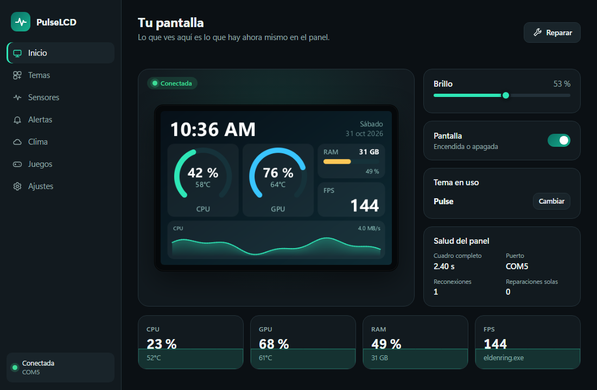
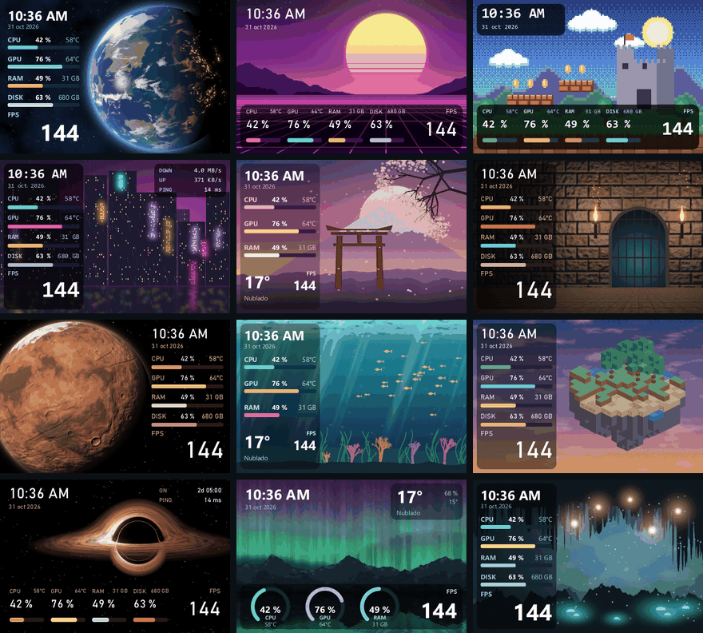
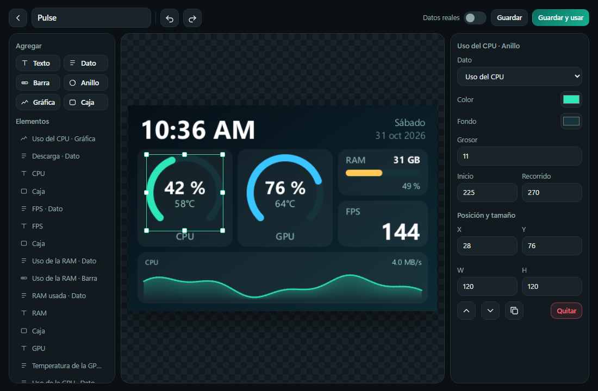

<div align="center">

# PulseLCD

**Your PC on a small screen: live stats, themes you can draw yourself, and a panel that looks after itself.**

**English** · [Español](README.es.md)

[](https://github.com/Yesid-Robayo/PulseLCD/releases)
[](LICENSE)

[](https://ko-fi.com/yesidrobayo)

<br>



</div>

> [!WARNING]
> **Personal project: use it at your own risk.** PulseLCD was made for its author's own use and is shared as is, with no
> warranty. It may not work with your display, and any problem that comes from using it is your responsibility.
>
> **Beta.** It has been tested on a single display (see the [test status](#-test-status)).

> [!IMPORTANT]
> **Only for the Turing Smart Screen 3.5" (480×320, first revision).** It's the only display PulseLCD has been tested on and the only
> one it detects. To check yours, look in Device Manager: its hardware ID must contain `VID_1A86&PID_5722`. If you have another size or
> model, this app isn't for you: don't download it.
>
> **Turn off Windows Fast Startup.** With it on, the display can stay black when you power on the PC. PulseLCD warns you if it's on
> and shows you the steps. [Why it matters](#-troubleshooting).

PulseLCD drives those small USB screens sold for PC cases and desks. It shows your CPU, GPU, memory, FPS and more, with themes
you can edit by dragging things around. It was written from scratch with one obsession: **these panels misbehave, so the app
has to fix them by itself**, without you reaching for the cable.

## Contents

- [Features](#-features)
- [A panel that looks after itself](#%EF%B8%8F-a-panel-that-looks-after-itself)
- [Test status](#-test-status)
- [Install](#-install)
- [How to use it](#-how-to-use-it)
- [Sensors](#%EF%B8%8F-sensors)
- [FAQ](#-faq)
- [Technology](#-technology)
- [Development](#-development)
- [Credits](#-credits)
- [Support the project](#-support-the-project)
- [License and contributions](#-license-and-contributions)

## ✨ Features

- **Live mirror:** the window shows exactly what is on the panel right now.
- **Visual theme editor:** drag, resize and align with guides, undo everything, and see the real result instantly. The preview
  is drawn by the same code that draws the panel.
- **Widgets:** text, values, bars, rings, history graphs and boxes, with any font from Windows or your own.
- **21 original themes:** space, pixel art, neon cities, dungeons, nature and more. Their backgrounds are generated by code in this
  repository, with no images from anyone else. Yours can use any image.
- **Metrics:** CPU, GPU, FPS (Frame Generation included), RAM, disk, network, latency, uptime, clock and weather.
- **Weather with no account:** from Open-Meteo, no API key. It's only asked for if your theme shows it.
- **Glanceable alerts:** a coloured frame and an icon for high temperature, and for peripherals that are low or finished
  charging, read from [YesCharge](https://github.com/Yesid-Robayo/YesCharge) or any compatible source.
- **Light on your PC:** only what changed is sent, and only what's shown is read. The window is a separate process that only
  exists while it's open.
- **Spanish and English,** light and dark.

<div align="center">


</div>

## 🛡️ A panel that looks after itself

This panel can't answer anything: it never confirms a command. So PulseLCD was built from what was measured on a real panel
(the details are in [docs/panel.md](docs/panel.md)):

- **Every session starts by resynchronising.** If the PC shut down in the middle of an image, the panel is left waiting for
  pixels, reads the next ones as commands and ends up resetting itself. Sending the rest of that image and then a harmless
  pattern brings it back **without resetting it**. In 12 of 12 tests on a real panel the USB didn't even drop.
- **It repaints by itself.** A few times after connecting and then every 30 minutes, it sends the same image again. If all is
  well you won't notice. If the screen got damaged, it heals on its own.
- **It measures the panel's health.** A full frame takes 2.40 s when the panel is drawing it and 2.33 s when it isn't. With no
  answers to read, that time is the only signal there is, and PulseLCD uses it to detect and fix a stuck panel.
- **Nothing is written halfway.** A single thread owns the port, so an image can't be mixed with another order, and a partial
  write is detected as such.
- **It never resets the panel on its own.** That stays as a last resort you choose, because a reset on a hung panel can make it
  vanish from USB until you unplug it.

> [!NOTE]
> If the panel's LCD itself hangs (black with the backlight on), software can't help: only cutting its power does. It's rare,
> and the [FAQ](#-faq) explains how to avoid it.

## 🧪 Test status

| Tested with | Result |
| --- | --- |
| Turing Smart Screen 3.5" (first revision, `1A86:5722`, serial `USB35INCHIPSV2`) | ✅ Works |
| Windows 11 build 26300 | ✅ Works |
| AMD Ryzen 7 9800X3D + NVIDIA RTX 5070 Ti | ✅ All sensors |

Only this panel is supported for now. Others, even if they look the same, may use a different protocol: PulseLCD won't try to
guess, so `auto` only accepts the identity above. If you try another one, [tell me how it went](https://github.com/Yesid-Robayo/PulseLCD/issues/new?template=panel.yml).

## 📦 Install

1. Download the latest `.zip` from [Releases](https://github.com/Yesid-Robayo/PulseLCD/releases) and check it against
   `SHA256SUMS.txt`.
2. Unzip it to a folder of your own and keep all the files together.
3. Open `PulseLCD.exe`. The welcome screen finds your panel and helps you pick a theme.

Windows 11 already has what it needs. On Windows 10 you may need the
[WebView2 Runtime](https://developer.microsoft.com/microsoft-edge/webview2/), for the window only.

> [!NOTE]
> The exe isn't signed with a paid certificate, so Windows SmartScreen may warn you the first time. Choose **More info → Run
> anyway** if the SHA256 matches.

## 🎮 How to use it

- **Home** shows the panel live, its brightness and its health. **Repair** resynchronises and repaints.
- **Themes:** press **Use**, or the pencil to edit. Built-in themes are edited directly, and you can always go **back to the original**.
  Remove the ones you don't want, one by one or several with **Select**. **Restore themes** lets you pick which ones come back, without
  touching the ones you have.
- **In the editor** drag elements, pull their handles to resize and use the guides to align them. Hold **Shift** to move freely,
  use the arrow keys for fine moves (with **Shift**, 10 pixels), **Ctrl+Z** to undo, **Ctrl+D** to duplicate and **Delete** to
  remove. Turn on **Real data** to preview with your PC's values.
- **Closing the window doesn't stop the display.** PulseLCD stays in the tray; quit from there or from Settings.

## 🌡️ Sensors

| Data | How it's read | Needs |
| --- | --- | --- |
| CPU usage, RAM, disk, network, latency, uptime | Windows API | Nothing |
| GPU usage, temperature, memory, fan, clock | NVML, from the NVIDIA driver | An NVIDIA card |
| CPU temperature | [PawnIO](https://pawnio.eu/) with its signed `RyzenSMU` module | AMD Ryzen, PawnIO and the helper |
| FPS | [PresentMon](https://github.com/GameTechDev/PresentMon): the copy in your AMD or NVIDIA driver, or the included one | The helper |
| Weather | [Open-Meteo](https://open-meteo.com/) | Internet, only if your theme shows it |
| Peripheral batteries | Local API of YesCharge or compatible ([format](docs/battery-api.md)) | That program running |

**CPU temperature and FPS need administrator rights, and the rest of the app doesn't.** So they live in a separate 350 KB helper
that does only that: it reads no files, doesn't touch the network and writes nothing to disk. Before anything changes, the app shows you exactly
what gets installed: its files in `C:\Program Files\PulseLCD` and one scheduled task, and you can remove them from Settings. Without it everything else keeps working. To install PawnIO:
`winget install namazso.PawnIO`.

## ❓ FAQ

<details>
<summary><b>The screen went black with the backlight on</b></summary>

The panel's LCD hung. Its microcontroller is still alive, so brightness responds, but nothing is drawn. **Unplug it and plug it
back in.** On the test machine this happened with Windows Fast Startup on, which keeps the USB port powered overnight: 21 of 63
hybrid boots failed against 0 of 21 full boots. Most full boots were restarts, so that's a strong hint, not proof. Turn off Fast
Startup: PulseLCD shows the steps, under Settings if you hid the notice. Sleep and hibernate keep working. If it still happens, enable
ErP / Deep Sleep in your BIOS.
</details>

<details>
<summary><b>It shows stripes or a shifted image</b></summary>

It should clear by itself within a minute. If not, press **Repair**. If you can reproduce it, please open an issue with your
`pulselcd.log`: it records how long every frame took.
</details>

<details>
<summary><b>FPS shows "--"</b></summary>

FPS is measured for the program in front, and needs the helper. If a program that isn't a game shows FPS, or the other way round,
adjust it in **Games**.
</details>

<details>
<summary><b>Does it work with my AMD or Intel graphics, or an Intel CPU?</b></summary>

Not yet: GPU data is NVIDIA only and CPU temperature is Ryzen only, because those are the only ones that could be tested. The
rest of the app works the same, and those values show as `--`.
</details>

<details>
<summary><b>Is my data sent anywhere?</b></summary>

No. PulseLCD has no telemetry and no accounts. It only connects to Open-Meteo for the weather (sending the coordinates you chose)
and, for the latency metric, pings the address in Settings. If you turn on the new-version notice, it also asks GitHub for the latest
version number. See [SECURITY.md](SECURITY.md).
</details>

## 🔧 Technology

Rust with no runtime, and a window in HTML and CSS on the WebView2 that comes with Windows. The engine draws each frame as a pure
function of the data, compares it with what's on the panel and sends only the difference, so the guardian that keeps the panel
healthy can be tested against a simulated panel that fails on demand. More in [docs/architecture.md](docs/architecture.md).

## 💻 Development

```powershell
cargo test                 # no panel needed: it uses a simulated one
cargo run -p pulselcd -- --agent
cargo run -p pulselcd
```

`cargo run -p pulse-panel --release --example lab` tests recovery on a real panel, with the agent closed.

## 🙏 Credits

- The panel's protocol was documented by the [turing-smart-screen-python](https://github.com/mathoudebine/turing-smart-screen-python)
  project. PulseLCD is a new implementation that shares no code with it.
- [PawnIO](https://pawnio.eu/) by namazso, [PresentMon](https://github.com/GameTechDev/PresentMon) by Intel,
  [Open-Meteo](https://open-meteo.com/) and the libraries in [THIRD_PARTY_NOTICES.txt](THIRD_PARTY_NOTICES.txt).
- **AI disclosure:** this app was developed with the help of AI tools.

## ☕ Support the project

PulseLCD is free. If it's useful to you, you can buy me a coffee on [Ko-fi](https://ko-fi.com/yesidrobayo).

## 📄 License and contributions

[MIT](LICENSE). This project doesn't accept pull requests, but reports of what works and what doesn't help a lot: see
[CONTRIBUTING.md](CONTRIBUTING.md). Security problems go through [SECURITY.md](SECURITY.md).
